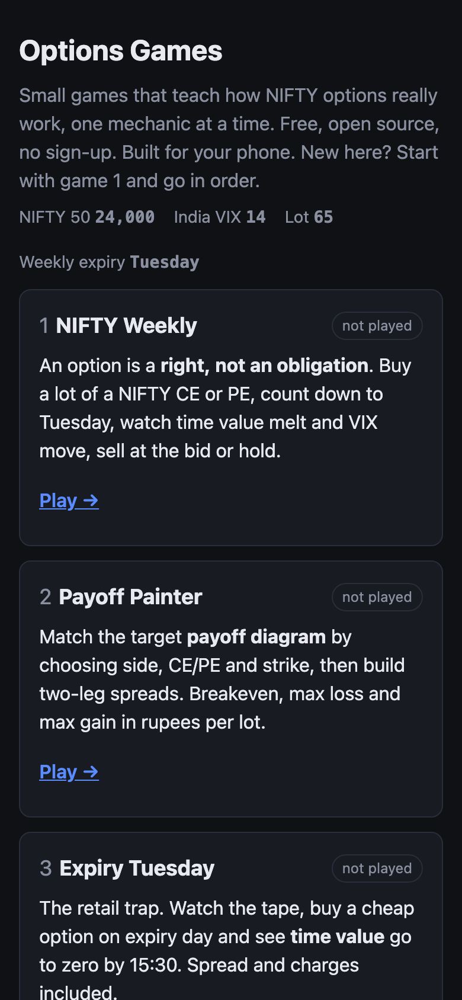
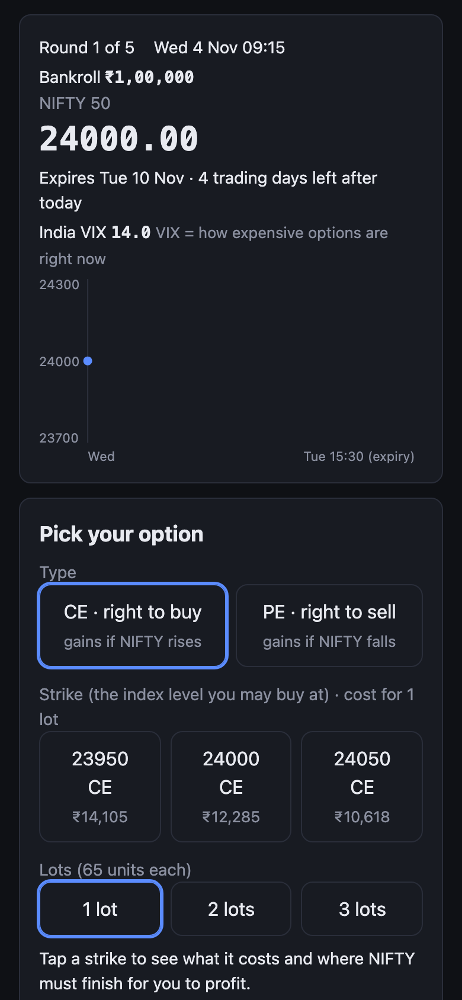
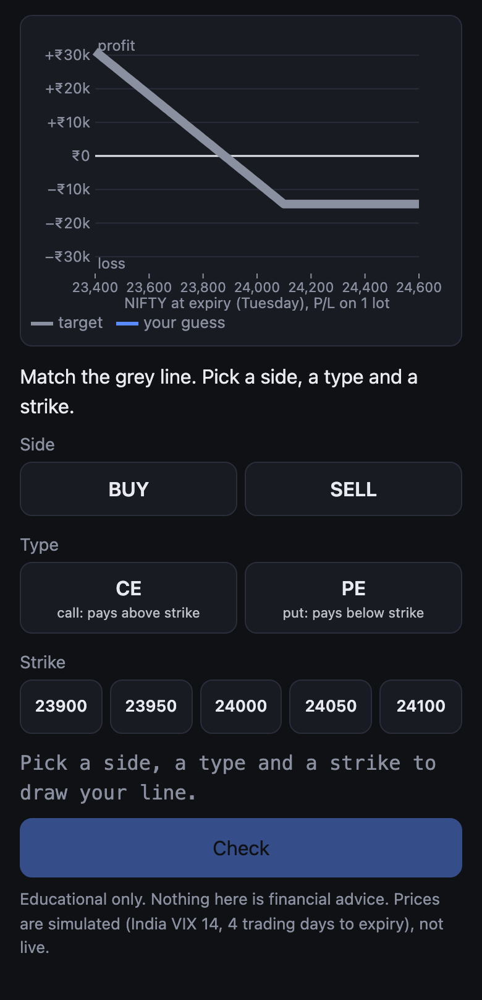
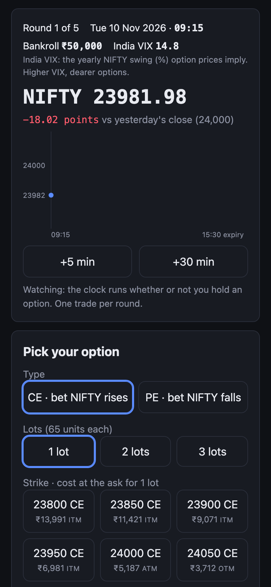
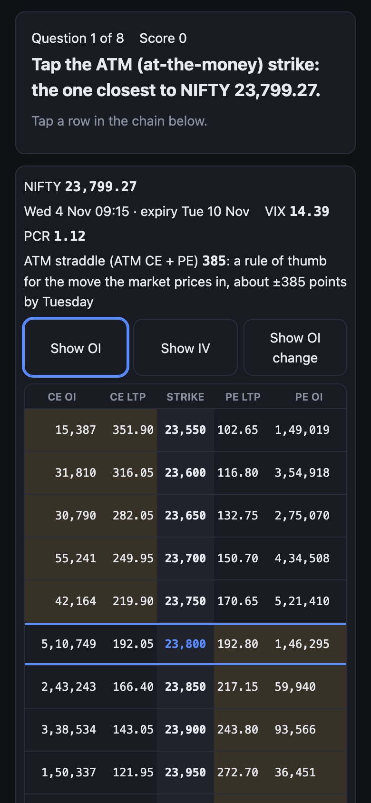
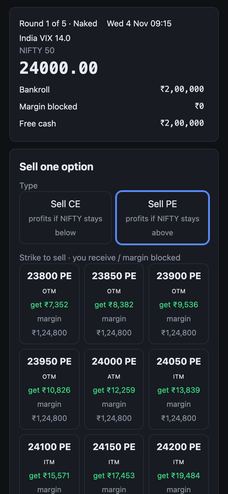
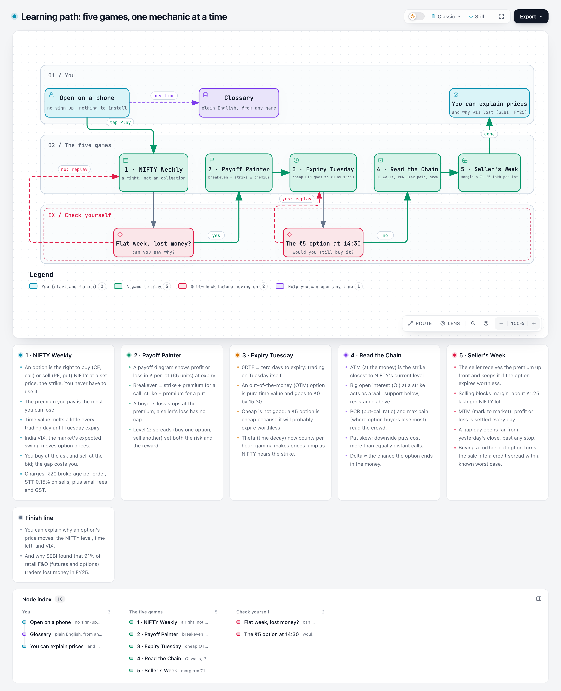

# Options Games

Small browser games that teach how options trading works on the Indian market (NSE / NIFTY), one mechanic at a time. No backend, no sign-up, no build step. Built for phones first.

Open `index.html` in a browser, or serve the folder with any static host (GitHub Pages works). **[How to play, and what each game teaches → docs/GUIDE.md](docs/GUIDE.md)** · [Glossary](glossary.html)

Every number on screen is one you would see on an Indian broker's app: NIFTY strikes in steps of 50, lots of 65, Tuesday expiry, bid/ask, brokerage and STT, India VIX. Prices are simulated by a model that follows NSE conventions. Educational only, not financial advice.

## The five games

| | Game | Teaches |
|---|---|---|
| 1 | **NIFTY Weekly** `games/ticket/` | An option is a right, not an obligation. Premium = max loss. Time value melts daily, VIX moves prices, you buy at the ask and sell at the bid. Greeks in ₹, P/L split by cause. |
| 2 | **Payoff Painter** `games/payoff/` | Read a payoff diagram: breakeven = strike ± premium, a buyer's loss is capped, a seller's is open. Level 2: two-leg spreads. |
| 3 | **Expiry Tuesday** `games/expiry/` | 0DTE: an out-of-the-money option is all time value and goes to zero by 15:30. Cheap is not good. Theta per hour, gamma. |
| 4 | **Read the Chain** `games/chain/` | The NSE option chain: ATM, OI walls, put–call ratio, max pain, put skew, delta as probability. |
| 5 | **Seller's Week** `games/seller/` | Sell an option: premium in, margin blocked, theta earned daily, a gap day, then hedge it into a credit spread. |

<p align="center">
     
</p>



More diagrams in the guide: [one round as a buyer](docs/diagrams/buyer-round.html), [where the rupees go in a trade](docs/diagrams/trade-money-flow.html), [a seller's week](docs/diagrams/seller-week.html), [how the project fits together](docs/diagrams/project-architecture.html). Each is an interactive page under `docs/diagrams/` with its source JSON (made with [Archify](https://github.com/tt-a1i/archify)) and a PNG.

## Shared code

`engine.js`, the maths:

- `Engine.price({type, S, K, T, sigma, r})` Black-Scholes price. `T` in years, `sigma` annualised.
- `Engine.greeks(...)` delta per point, gamma, theta per trading day, vega per volatility point.
- `Engine.payoff(type, S, K)` intrinsic value at expiry.
- `Engine.rng(seed)` seeded random numbers; `Engine.pricePath(...)` plain lognormal path.
- `Engine.progress.load()` / `Engine.progress.done(game, score)` cross-game progress in localStorage.

`market.js`, the Indian market:

- `Market.INDICES` NIFTY (step 50, lot 65, weekly Tuesday expiry) and BANKNIFTY (step 100, lot 30, monthly last Tuesday). Jan 2026 series.
- `Market.strikes`, `Market.atm`, `Market.nextExpiry`, `Market.tradingDaysBetween`, `Market.yearsToExpiry(now, expiry)` time to expiry down to the minute of the 09:15–15:30 session. NSE holidays are ignored.
- `Market.iv({S, K, T, vix})` implied volatility with an index skew (OTM puts dearer than OTM calls); `Market.premium({type, S, K, T, vix})` price ticked to 0.05; `Market.greeks(...)` at the strike's IV.
- `Market.fill({premium, side})` buy at the ask, sell at the bid (one tick minimum, ~0.2% on dear options).
- `Market.charges({side, premium, qty, exercised})` brokerage ₹20, STT 0.15% on sell premium / on intrinsic at a buyer's settlement (April 2026 rates), exchange 0.035%, SEBI, stamp duty, GST 18%; `Market.netPnl(...)` round-trip gross, charges, net.
- `Market.shortMargin`, `Market.spreadMargin` seller margin (≈ 8% of notional; ≈ max loss × 1.1 for a spread).
- `Market.simulate({S0, days, vix, seed})` daily closes plus a VIX path (mean-reverting, jumps when the index falls, fat-tailed moves); `Market.intradayPath(...)` one session of ticks with an overnight gap and U-shaped intraday volatility.
- `Market.fmt(x)` rupees with Indian grouping (₹1,05,603), `Market.hhmm(minutes)`.

## Testing

Unit tests (node, no dependencies): `npm test`, or `for t in test/*.js; do node $t; done`.

End-to-end: `e2e/run.js` plays the games in a real browser the way a person does (taps, wrong guesses, impatient double taps, keyboard only, several screen sizes, light mode, WebKit) and records each play as a video with screenshots of every state.

```sh
npm run e2e                                  # all scenarios, Chromium, 360×740, dark
npm run e2e:webkit                           # same in WebKit (Safari engine)
node e2e/run.js 30 --width=390 --height=844 --scheme=light   # one scenario, other settings
PLAYWRIGHT_PATH=/path/to/node_modules/playwright npm run e2e  # use an already-installed Playwright
npm run screenshots                          # refresh docs/screenshots/
```

Each scenario writes `e2e/artifacts/<scenario>/play.webm` and numbered screenshots; `e2e/artifacts/report.md` lists PASS/FAIL per scenario with links. CI (`.github/workflows/test.yml`) runs unit tests and both browsers and uploads `e2e/artifacts`. The scenarios cover the first three games; the branch `tooling/e2e-v2` holds unfinished scenarios for the v2 flows, Read the Chain and Seller's Week.

The manual checklist is in [TESTING.md](TESTING.md): every game was played through it with recorded sessions (beginner, impatient, boundaries, six screen sizes, light mode, keyboard only, WebKit) before merging.

## Contributing

One folder per game under `games/`. A game is a single `index.html` that loads `../../engine.js`, `../../market.js` and `../../style.css`, with its pure logic in `logic.js` using the same module pattern so it can be tested in node (`test/<game>.test.js`). Keep it playable at 360px wide with 44px tap targets, in light and dark, with the keyboard, and reload-safe. Add a card to `index.html` and a section to `docs/GUIDE.md`.

Planned next: event days with an IV ramp and crush (RBI, Budget, election results), r = 6.5% carry and the futures price, historical replay from NSE data you download yourself, live paper trading with your own broker API key, Hindi UI, PWA.

Educational only. Nothing here is financial advice. All prices are simulated. Contract specs and charges change; check NSE circulars before relying on any number.

MIT License.
