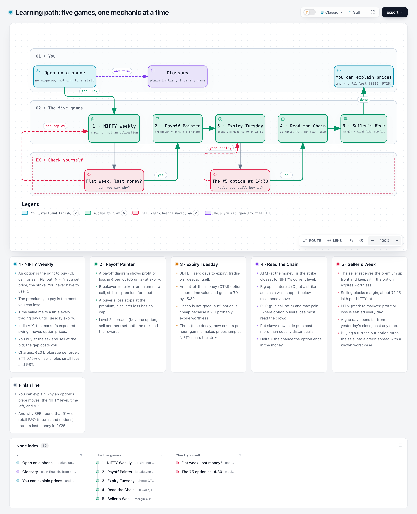
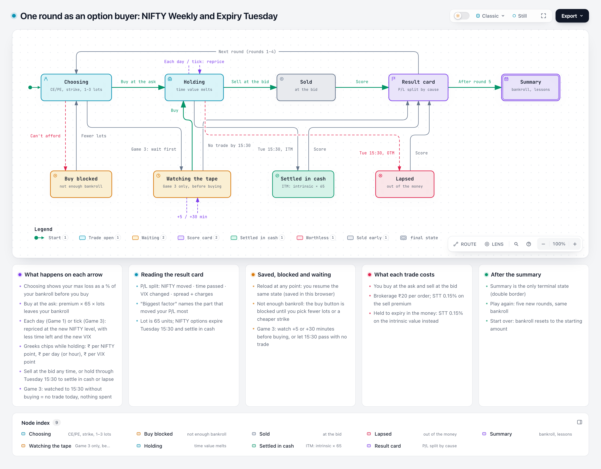
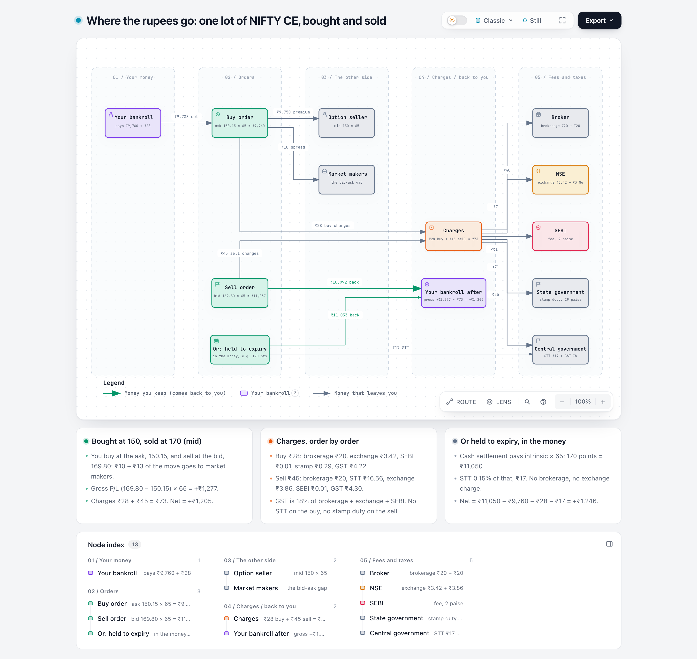
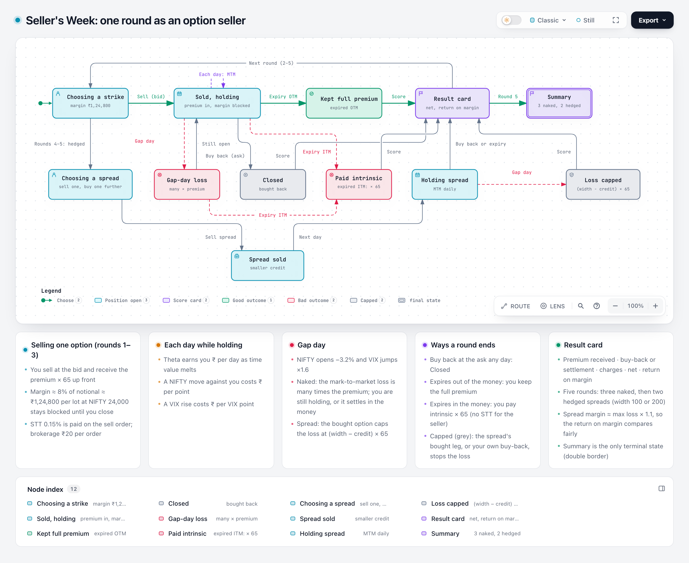
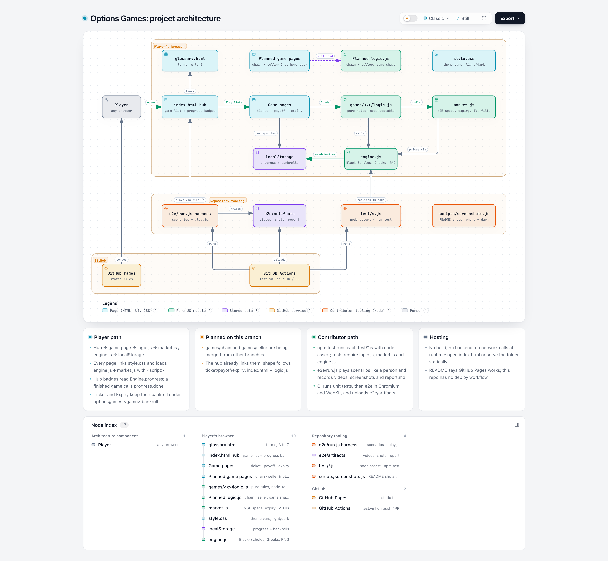

# How to play, and what each game is trying to teach

Five small games, ten to fifteen minutes each, built for a phone. Play them in order: each one assumes the one before it. Every number you see is one you would see on an Indian broker's app: NIFTY strikes in steps of 50, lots of 65, Tuesday expiry, charges and STT, India VIX. Prices are simulated by a model that follows NSE conventions; nothing here is financial advice.

[Interactive version](diagrams/learning-path.html) · [Glossary](../glossary.html) of every term used below.

**Progress and money.** Each game has its own paper bankroll, saved in your browser. The hub shows a badge when you have finished a game. "Play again" keeps your bankroll; "Start over" resets it. Reloading a page brings you back to exactly where you were.

---

## 1. NIFTY Weekly

**Intention.** An option is a *right, not an obligation*. The premium you pay is the most you can lose. Then the harder lesson: the premium is mostly *time value*, and time value melts every day whether or not NIFTY moves. You also meet the three things that quietly take money from retail buyers: the bid–ask spread, charges, and a falling VIX.

**How to play.**
1. It is Wednesday 09:15, NIFTY is at 24,000, expiry is Tuesday 15:30 (4 trading days). Pick CE (pays if NIFTY ends above the strike) or PE (pays if it ends below), a strike (one in the money, the at-the-money, one out of the money) and 1–3 lots.
2. Read the line "Max loss ₹x = y% of your bankroll" before you tap Buy. You buy at the **ask**.
3. Tap **Next day**. NIFTY moves, a day of time value disappears, VIX changes. The three chips under your position tell you what you are exposed to: **Delta** (₹ per 1-point NIFTY move), **Theta** (₹ you lose per day if nothing moves), **Vega** (₹ per 1-point VIX change).
4. **Sell now** at the **bid** on any day, or hold through Tuesday 15:30: in the money settles in cash for its intrinsic value, out of the money lapses at zero.
5. The result card splits your profit or loss into *NIFTY moved · time passed · VIX changed · spread + charges*, and names the biggest. Five rounds, then a summary.

[Interactive version](diagrams/buyer-round.html)

**What to notice.** A week where NIFTY barely moves still loses money: look at the "time passed" row. A calm market lowers VIX and takes a little more. Three lots triple the risk while the brokerage barely changes. The break-even on the buy screen already includes charges; the strike alone is not enough.

**Mistakes it exposes.** Buying an out-of-the-money option with days left and expecting a small move to pay; ignoring theta; sizing a trade by how cheap it looks rather than by the percentage of the bankroll at risk.

---

## 2. Payoff Painter

**Intention.** Read a payoff diagram at a glance: where it bends (the strike), where it crosses zero (breakeven = strike ± premium), and the two shapes that matter most: a buyer's loss is capped at the premium, a seller's gain is capped at the premium and the loss is open. Level 2 shows how two legs together shape risk.

**How to play.**
1. A grey target line shows profit or loss in rupees per lot against where NIFTY ends on Tuesday.
2. Pick BUY or SELL, CE or PE, and a strike. Your coloured line is drawn over the target. Tap **Check**.
3. A wrong guess gets a hint that names every wrong field. A right one shows breakeven, max loss, max gain, the premium in points and rupees, and what the round trip costs in charges.
4. After eight single-leg puzzles, Level 2: build **two legs** to match a bull call spread, a bear put spread, a long straddle and a short strangle.

**What to notice.** A sold CE's line falls forever; a sold PE's stops at (strike − premium) × 65, about ₹15 lakh, which only happens if NIFTY fell to zero. A spread costs less than the option alone and caps the gain. A straddle needs NIFTY to move more than both premiums together to pay.

**Mistakes it exposes.** Selling an option because "it will probably expire worthless" without knowing what the other side of the line looks like.

---

## 3. Expiry Tuesday

**Intention.** On expiry day an out-of-the-money option is *all* time value, and it goes to zero by 15:30 unless NIFTY actually crosses the strike. The cheap "₹5 option with 10× potential" is cheap because it will almost certainly die. This is the single most common way Indian retail traders lose, and SEBI's FY25 study found 91% of individual F&O traders lost money.

**How to play.**
1. It is Tuesday 09:15. The tape ticks every five minutes until 15:30. Use **+5 min** and **+30 min** to watch before you buy; the cheap options get cheaper as the day goes on.
2. Nine strikes in a grid, each with its cost for your lots and an ITM / ATM / OTM tag. Pick 1–3 lots, read the max-loss line, buy at the ask.
3. While holding: a bar shows how much of your premium is time value and how it shrinks; **Theta** is shown per hour here.
4. **Sell now** at the bid, or hold to 15:30 for cash settlement. The result card splits P/L into *NIFTY moved · time passed · gamma · spread + charges*.
5. The summary counts how many rounds "looked like a winner" (the premium doubled at some point) against how many ended net positive.

[Interactive version](diagrams/trade-money-flow.html)

**What to notice.** How often the premium doubles and then dies. Theta per hour after lunch. How a small scalp disappears into the spread and charges. Gamma: on expiry day the option's delta changes fast, so the same 50-point move is worth very different amounts at 10:00 and at 15:00.

**Mistakes it exposes.** Buying a lottery ticket at 09:15 and holding it hoping; averaging down; "it was in profit, I should have sold" (the counts show how rarely that is a repeatable plan).

---

## 4. Read the Chain

**Intention.** The NSE option chain is the screen every Indian options trader stares at. Learn what each column means and the handful of readings people take from it, and learn which of those are conventions rather than laws.

**How to play.**
1. A chain for the current weekly expiry: calls on the left, puts on the right, strikes in the middle. Toggle between open interest, IV and change in OI.
2. Eight questions, each answered by tapping a row or cell, or a multiple choice: find the at-the-money strike; the call wall and the put wall (the biggest OI each side, read as resistance and support); which option is dearest and why; why the 200-point-away put has a higher IV than the 200-point-away call (skew); what the put–call ratio says; the max-pain strike; and roughly what chance the market gives an out-of-the-money option (its delta).
3. One answer per question, then the explanation. Score = first-try correct. Play again deals a new chain.

**What to notice.** Open interest piles up at round strikes. The ATM straddle price is the market's own estimate of how far NIFTY will move by expiry. Delta is a probability you can read straight off the chain: a ₹5 option is a 3–5% bet.

**Mistakes it exposes.** Treating "max pain" or "the wall" as a forecast. Comparing IVs across strikes without knowing skew exists.

---

## 5. Seller's Week

**Intention.** The other side of every trade. Selling an option means collecting the premium now, blocking a large margin, earning time decay day by day, and carrying a loss that can be many times the premium. Then the fix: a credit spread caps the loss and cuts the margin, at the cost of a smaller credit.

**How to play.**
1. Rounds 1–3, naked: SELL one NIFTY CE or PE. The grid shows the premium you would receive at the bid and the margin blocked (≈ ₹1.25 lakh per lot). STT is paid on your sell order.
2. Each day you are marked to market: the option's current ask, your running P/L, margin. The Greeks are shown from a seller's side: theta earns, a move against you costs, a VIX rise costs. **Buy back** at the ask, or hold: out of the money keeps the whole premium; in the money pays intrinsic × 65.
3. Round 3 is a gap day: NIFTY opens 3.2% lower and VIX jumps. Watch what that does to a sold put.
4. Rounds 4–5, hedged: sell one option and buy a further-out one (100 or 200 points wide). Margin drops to about the maximum loss; the loss is capped at (width − credit) × 65. Round 5 replays the gap day with the spread.

[Interactive version](diagrams/seller-week.html)

**What to notice.** The most a seller can make is the premium. One gap day can erase many weeks of it. Return on margin: ₹5,000 earned on ₹1.25 lakh blocked is 4% in four days, which looks great until the week that costs ₹40,000. The spread's return on margin is often higher because the margin is so much smaller.

**Mistakes it exposes.** Selling naked for "safe income"; sizing by premium received instead of by the worst case; not knowing what margin is until the broker's call.

---

## Under the hood

Everything runs in your browser from static files; nothing is sent anywhere. Prices come from a Black–Scholes model with an index skew (out-of-the-money puts carry a higher implied volatility than calls), driven by an India VIX that mean-reverts and jumps when NIFTY falls. Daily moves have fat tails; intraday ticks open with a gap and are busier at the open and close. Fills are at the ask or bid; charges follow the April 2026 schedule (brokerage ₹20 per order, STT 0.15% on sells and on a buyer's in-the-money settlement, exchange charge, SEBI fee, stamp duty, GST). Margin for a naked short is approximated as 8% of notional. Contract specs are the January 2026 series (NIFTY lot 65, BANK NIFTY lot 30). NSE holidays are ignored. Details and formulas: [README](../README.md), `engine.js`, `market.js`.

[Interactive version](diagrams/project-architecture.html)

## Running a session with others

A sixty-minute workshop that works: Game 1 (15 min) → ask everyone why their flat-week round lost money → Game 3 (15 min) → compare "looked like a winner" counts across the room → Game 5 (15 min) → ask what the gap day did to the naked put versus the spread. Game 2 and Game 4 work well as homework. Questions worth asking at the end: What is the most a buyer can lose? What is the most a seller can make? Why is a ₹5 option ₹5? What would you check on the chain before any trade?

## Reality check

SEBI's FY25 study: 91% of individual F&O traders lost money, net losses ₹1.05 lakh crore, with index options making up about 95% of retail derivatives volume. The games are here so that the first ₹1 lakh you lose is paper.
